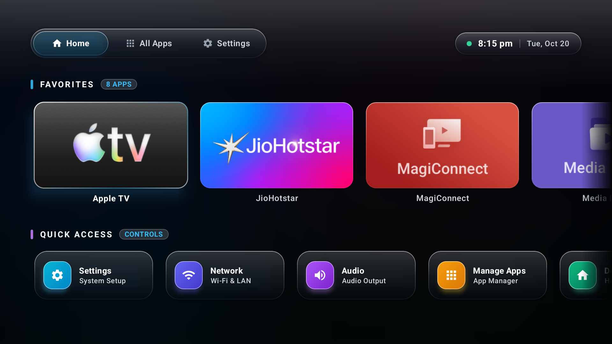
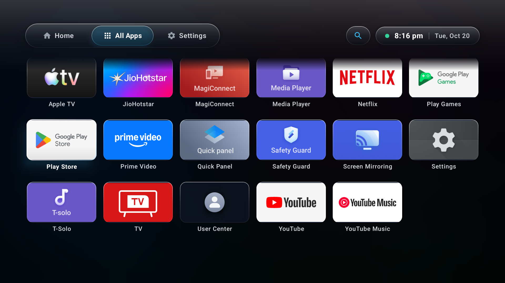
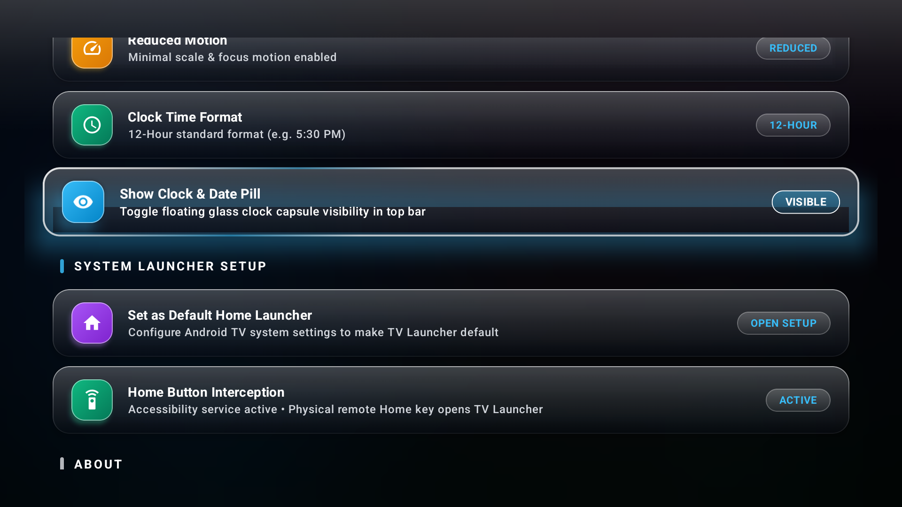

# TV Launcher

A minimalist, ultra-high-performance home launcher crafted for **Android TV** and **Google TV** devices. Built with an TVOS–inspired frosted glass aesthetic, luminous atmospheric backdrops, calm typography, instant D-pad navigation, and **zero advertisements, tracking, or sponsored clutter**.

---

## Visual Showcase

| Home Screen & Quick Controls | All Applications & Top Search |
|:---:|:---:|
|  |  |
| *Favorites row with illuminated glass glow & Quick Access center* | *Compact 6-column rectangular cards with on-demand search & clock pill* |

| Settings & System Launcher Setup |
|:---:|
|  |
| *Atmospheric theme controls, glass depth, and Home Key Interception toggle* |

---

## Key Features

### 🌟 1. Frosted Glass Aesthetic
* **Liquid Glass Engine & Atmospheric Backdrop:** Real-time multi-layered celestial orbs (Sapphire, Violet, Cyan, Emerald, Rose) providing vibrant depth and optical refraction behind frosted glass surfaces.
* **Hardware-Accelerated Blur:** Dynamic hardware blur on Android 12+ (`Modifier.blur(48.dp)`) optimized for TV GPUs.
* **Pure Optical Dissolve:** Uses GPU alpha masking (`BlendMode.DstIn`) on scrollable list edges, completely eliminating muddy dark overlays or color tinting.
* **Translucent Focus Highlighting:** Airy, glowing glass focus states (`1.06x` spring scale, delicate 1.5dp specular edge bevels, and colored backlight radiance).

### ⚡ 2. Gliding Navigation & Parallax Transitions
* **Floating Segmented Navigation Island:** Ergonomic pill bar (`Home`, `All Apps`, `Settings`) with a physical gliding selector pill that animates smoothly between tabs.
* **Executive Clock Capsule:** Floating frosted glass pill featuring live 12h/24h time, date, and pulsing emerald network status beacon.
* **Directional Screen Glide:** Subtle horizontal parallax glide (`slideInHorizontally` + `fadeIn`) between tabs with zero frame drops or GPU re-allocations.

### 🎮 3. Favorites Management & Remote-First Controls
* **Custom Favorites Bar:** Pin top streaming apps to the main dashboard.
* **Remote Reordering Dialog:** Press `Menu` or long-press `D-pad Center` on any app to open a remote-first modal dialog:
  * Move Left / Move Right
  * Add to / Remove from Favorites
  * Open App Details / System Info
* **Persistence:** User arrangements are automatically persisted locally via Jetpack DataStore.

### 📱 4. All Applications Screen & On-Demand Search
* **Compact 6-Column Grid:** Uniform rectangular cards (`132dp x 78dp`) displaying TV banners or centered squircles with zero icon clipping.
* **On-Demand Search:** Dedicated search icon (`🔍`) integrated into the top bar. Expands smoothly with an auto-focused search field and real-time app filtering.
* **Seamless Back Navigation:** Pressing remote `Back` collapses search and restores the full app list without exiting the screen.

### ⚙️ 5. Quick Access Center & Customization
* **Quick Access Controls:** One-click frosted glass cards to launch TV Settings, Wi-Fi/Network, Audio Output, and Manage Installed Apps.
* **Theme Modes:** Choose between **Dark Glass**, **OLED Black**, and **Subtle Gradient**.
* **Glass Depth:** Adjustable blur intensity (`Off`, `Low`, `Medium`, `High`).
* **Reduced Motion:** Optional low-animation mode for older or resource-constrained TV chipsets.

### 🛡️ 6. Privacy & Performance
* **100% Offline-First:** Zero network requests, zero telemetry, zero analytics, zero external SDKs.
* **Zero Ads:** Completely eliminates sponsored recommendations and video autoplay ads.
* **Battery & Memory Conscious:** Lazy layouts, lean memory footprint, and sub-second cold starts.

### 🏠 7. Physical Remote Home Key Interception (Optional)
* **Standard Android TVs:** Works out of the box with standard `CATEGORY_HOME` intent filters.
* **Google TV & TCL Bypass:** Includes an optional, lightweight `LauncherAccessibilityService` that prevents OEM launchers (`launcherx`) from overriding the remote's Home button without modifying or disabling system packages.

---

## Supported Devices & Platform Requirements

* **Target Platforms:** Android TV & Google TV (TCL, Sony, Philips, Chromecast with Google TV, Nvidia Shield, Mi Box, etc.)
* **Minimum Android Version:** Android 9.0 (API level 28)
* **Target Android Version:** Android 14 / 15 (API level 34 / 35)
* **Display Resolutions:** Fully responsive 1080p (Full HD) and 4K (Ultra HD) layouts with overscan safe margins.

---

## Installation & Setup Guide

### 1. Build the APK from Source
```bash
# Clone the repository
git clone https://github.com/rishavsharma/tv_launcher.git
cd tv_launcher

# Build debug APK
./gradlew assembleDebug
```
The output APK will be available at:
```
app/build/outputs/apk/debug/app-debug.apk
```

---

### 2. Connect Your TV via ADB

1. On your Android TV / Google TV, go to:
   * **Settings** -> **System** -> **About** -> Click **Android TV OS build** 7 times to enable Developer Options.
2. Go to **Settings** -> **System** -> **Developer Options** and enable:
   * **USB Debugging** (or **Wireless Debugging**).
3. Connect from your computer:
   ```bash
   # Connect to TV IP address
   adb connect <TV_IP_ADDRESS>:5555

   # Verify connection
   adb devices
   ```

---

### 3. Install the Launcher
```bash
./gradlew installDebug
# OR directly via adb:
adb install -r app/build/outputs/apk/debug/app-debug.apk
```

---

### 4. Setting as Default Launcher

#### Option A: Inside TV Launcher (Remote Only)
1. Open **TV Launcher** on your TV.
2. Navigate to the **Settings** tab.
3. Under **SYSTEM LAUNCHER SETUP**, click **Set as Default Home Launcher**.
4. In Android's system dialog, select **TV Launcher** -> **Always**.

#### Option B: Via TV System Settings
1. Open TV **Settings** -> **Apps** -> **Special app access**.
2. Select **Default apps** -> **Home app**.
3. Choose **TV Launcher**.

---

### 5. (Optional) Enabling Remote Home Interception for Google TV & TCL

On some Google TV and TCL firmware, the physical remote Home button is hardcoded to Google's `launcherx`. TV Launcher provides a non-destructive accessibility interceptor to solve this.

#### Method 1: Using the TV Remote
1. Open TV Launcher -> **Settings** tab.
2. Under **SYSTEM LAUNCHER SETUP**, click **Home Button Interception** (`[ CONFIGURE ]`).
3. In the system Accessibility menu, scroll down to **Services** -> **TV Launcher Home Interceptor** -> toggle it **ON** and confirm.
4. *(If sideloaded on Android 13/14)*: If Android shows "Restricted setting", go to TV Settings -> Apps -> TV Launcher -> click **Allow restricted settings**, then enable it in Accessibility.
5. In TV Launcher Settings, the badge will now display **`[ ACTIVE ]`**.

#### Method 2: Instant 1-Line ADB Setup (For Developers)
```bash
adb shell settings put secure enabled_accessibility_services com.glasstv.launcher.debug/com.glasstv.launcher.service.LauncherAccessibilityService
adb shell settings put secure accessibility_enabled 1
adb shell appops set com.glasstv.launcher.debug AUTO_START allow
```

---

## Remote Control Cheatsheet

| Button | Action |
|---|---|
| **D-pad Arrows** | Navigate through app tiles, tabs, and quick settings |
| **D-pad Center** | Launch selected app or open setting |
| **Menu / Long-Press Center** | Open Favorites Reorder / Action Dialog |
| **Back Button** | Collapse Search -> Return to Home -> Stay on Launcher |
| **Home Button** | Immediately brings TV Launcher Home to the front |

---

## Tech Stack & Architecture

* **UI Framework:** Jetpack Compose for TV (`androidx.tv:tv-material`, `androidx.tv:tv-foundation`).
* **Language & Runtime:** Kotlin 2.0.21, Coroutines, StateFlow, AndroidX Lifecycle 2.8.
* **Architecture:** Unidirectional Data Flow (UDF) with MVVM clean architecture.
* **Graphics & Rendering:** Hardware render nodes (`RenderEffect.createBlurEffect`), custom `Brush` gradients, and `BlendMode.DstIn` alpha composition.
* **Local Storage:** Jetpack DataStore Preferences for instant, synchronous-feeling startup reads.
* **Package Monitoring:** Dynamic broadcast receiver (`PackageChangeReceiver`) for live app installs/updates without app restart.

---

## Documentation Links

* [Project Specification (`PROJECT_SPEC.md`)](PROJECT_SPEC.md) — Comprehensive functional requirements & design guidelines
* [System Architecture (`ARCHITECTURE.md`)](ARCHITECTURE.md) — Layered architecture, state flow & component diagrams
* [Engineering Rules (`RULES.md`)](RULES.md) — Coding conventions & review checklist
* [Project Status & Roadmap (`STATUS.md`)](STATUS.md) — Milestones, completed deliverables & active backlog
* [Changelog (`CHANGELOG.md`)](CHANGELOG.md) — Version history and release notes
